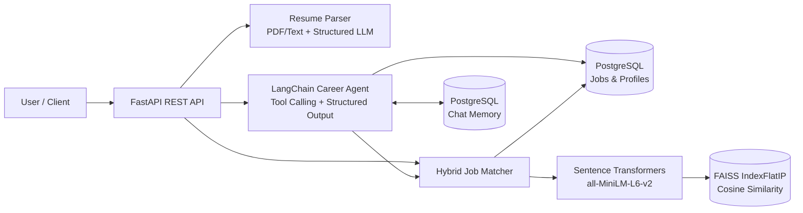

# AI Career Agent & Semantic Job Matching System

An end-to-end LLM-powered career assistant and semantic job recommendation engine built with **Python, FastAPI, LangChain, Sentence Transformers, PostgreSQL, FAISS, and Docker**.

## Architecture



## Key Features

- **LLM-Powered Career Agent:** Built with LangChain tool calling (`semantic_job_search`, `analyze_skill_gap`, `filter_jobs`), PostgreSQL-backed conversational memory, and Pydantic-enforced structured outputs (`CareerAgentResponse`).
- **Semantic Search & Hybrid Re-Ranking:** Encodes job descriptions and candidate profiles with `all-MiniLM-L6-v2` into 384-D normalized vectors indexed in FAISS (`IndexFlatIP`). Combines:
  - **45%** Semantic Embedding Similarity (FAISS cosine score)
  - **30%** Required Skill Coverage
  - **15%** Experience Alignment
  - **10%** Location & Work-Mode Preferences
- **Structured Resume Parsing:** Accepts `.pdf`, `.txt`, or raw text via FastAPI and extracts normalized skills, experience, target roles, and work preferences (includes a deterministic fallback parser when no API key is configured).
- **Retrieval Evaluation Suite:** Measures **Precision@K**, **Recall@K**, and **Mean / P50 / P95 FAISS retrieval latency (ms)** across labeled candidate queries.

## Tech Stack

| Layer | Technology |
|---|---|
| API Framework | FastAPI, Uvicorn, Pydantic v2 |
| LLM & Agent Orchestration | LangChain (`langchain-core`, `langchain-openai`) |
| Embeddings & Vector Search | Sentence Transformers (`all-MiniLM-L6-v2`), FAISS (`IndexFlatIP`) |
| Database & Memory | PostgreSQL 16, SQLAlchemy 2.0 |
| Containerization | Docker, Docker Compose |

## Quickstart (Docker Compose)

1. **Clone and configure environment variables:**
   ```bash
   git clone [https://github.com/](https://github.com/)<your-username>/ai-career-agent.git
   cd ai-career-agent
   cp .env.example .env
   # Edit .env and add your OPENAI_API_KEY (or compatible base URL)
   ```

2. **Start PostgreSQL and FastAPI:**
   ```bash
   docker compose up --build -d
   ```

3. **Seed sample jobs and build the FAISS index:**
   ```bash
   docker compose exec api python -m data.seed_jobs
   ```

4. **Explore Interactive Swagger Docs:**
   Open [http://localhost:8000/docs](http://localhost:8000/docs).

## Local Development (Without Docker)

```bash
python -m venv .venv
source .venv/bin/activate  # Windows: .venv\Scripts\activate
pip install -r requirements.txt
cp .env.example .env
python -m data.seed_jobs
uvicorn app.main:app --reload
```

## API Endpoints

| Method | Endpoint | Description |
|---|---|---|
| `GET` | `/api/v1/health` | Service health, PostgreSQL job count, and FAISS vector count |
| `POST` | `/api/v1/jobs` | Ingest a job posting and update the FAISS index |
| `POST` | `/api/v1/jobs/bulk` | Bulk-ingest job postings into PostgreSQL and FAISS |
| `GET` | `/api/v1/jobs` | List stored jobs |
| `POST` | `/api/v1/resumes/parse` | Parse raw resume text into a structured `CandidateProfile` |
| `POST` | `/api/v1/resumes/upload` | Upload a `.pdf` or `.txt` resume and extract structured profile |
| `POST` | `/api/v1/jobs/match` | Semantic retrieval + multi-factor ranking with latency stats |
| `POST` | `/api/v1/agent/chat` | Conversational Career Agent with tool calling and session memory |

### Example Requests

**1. Parse a Resume:**
```bash
curl -X POST http://localhost:8000/api/v1/resumes/parse \
  -H "Content-Type: application/json" \
  -d '{
    "raw_text": "Jane Doe (jane@example.com) - 2 years experience in Python, FastAPI, LangChain, PostgreSQL, Docker, and FAISS. Seeking remote AI Engineer roles."
  }'
```

**2. Run Semantic Job Matching:**
```bash
curl -X POST http://localhost:8000/api/v1/jobs/match \
  -H "Content-Type: application/json" \
  -d '{
    "candidate_id": 1,
    "top_k": 3
  }'
```

**3. Chat with the AI Career Agent:**
```bash
curl -X POST http://localhost:8000/api/v1/agent/chat \
  -H "Content-Type: application/json" \
  -d '{
    "session_id": "user-session-001",
    "candidate_id": 1,
    "message": "Recommend my top 3 remote AI roles and tell me what skills I am missing for the best match."
  }'
```

## Evaluation (Precision@K, Recall@K & Latency)

Run the benchmark script against the seeded job index:

```bash
docker compose exec api python -m evaluation.evaluate_retrieval
# or locally:
python -m evaluation.evaluate_retrieval
```

Sample output:
```text
=== Semantic Job Matching Evaluation Report ===
Indexed Jobs: 10 | Queries Evaluated: 4

| K | Precision@K | Recall@K |
|---|-------------|----------|
| 1 | 1.0000      | 0.3750   |
| 3 | 0.8333      | 0.9167   |
| 5 | 0.5500      | 1.0000   |

Retrieval Latency (FAISS):
- Mean: ~14.20 ms
- P50:  ~13.80 ms
- P95:  ~16.50 ms
```

## License

MIT License
